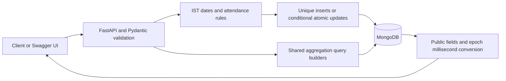

# Understanding and demonstrating the project

This is the backend of an attendance system. A frontend or mobile app would call
these endpoints when an employee clocks in or out. HR can correct a record, and
managers can request reports. FastAPI's `/docs` page provides a way to try it without
building a frontend.

The starter already had employee creation/listing and a basic attendance punch-in
and list. It lacked seven endpoints and had correctness, concurrency, and scaling
problems. This implementation completes the contract and fixes those problems.

## Request flow



There are two collections. `employees` holds shifts and departments.
`attendance_logs` holds one record per employee and attendance date, including its
embedded manual-correction history. The application does not need a second audit
collection or a transaction to change one record and append its history together.

## Demonstration

Use `/docs` against your development database. Pick an unused employee code so that
repeating the demo does not conflict with an earlier run.

1. Create an employee with `POST /employees`:

   ```json
   {"emp_code":"EMP9001","name":"Demo Employee","email":"demo@example.test","department":"Demo","joined_on":"2026-07-01"}
   ```

2. Punch in with `POST /attendance/punch-in`. Send `emp_code` and optionally an
   integer `punched_at`. Omitting it uses now. Repeat the same request to see the
   409 duplicate response.
3. Punch out with a later instant through `POST /attendance/punch-out`. Inspect
   `work_hours`, `half_day`, and overtime. History is still empty.
4. Correct that record using `PATCH /attendance/{emp_code}/{date}`. For example,
   change status to `WFH`, provide `reason: "Approved remote work"` and
   `regularized_by: "demo.hr"`. Inspect the single appended before/after entry.
5. Request employee monthly, department summary, lateness leaderboard, and trend
   reports using dates containing the demonstration record.
6. Call `/admin/explain/employee_monthly` with `emp_code` and `month`; inspect the
   actual `IXSCAN` plan and execution statistics. Other explain targets cover the
   attendance list, department summary, leaderboard, and trend.

For a historical timestamp, this Python example converts an explicit IST time:

```python
from datetime import datetime
instant = datetime.fromisoformat("2026-07-06T09:40:01+05:30")
print(int(instant.timestamp() * 1000))
```

## Design points to explain in an interview

- **Time:** store instants in UTC, derive calendar days in IST, and truncate
  milliseconds first. An overnight shift ends the next day; a post-midnight
  punch before its end belongs to the previous attendance date.
- **Rounding:** work hours use Python `Decimal`. Aggregations use decimal
  arithmetic and explicit half-up rounding because MongoDB `$round` uses a
  different tie rule. Half-day compares the already rounded hours with 4.50.
- **Concurrency:** unique indexes choose the winner of duplicate insert races.
  For updates, the filter includes the originally read values and history length.
  If another request changes them first, the update fails with 409. `$push` and
  `$set` execute atomically on the same document.
- **Reports:** aggregate stored metrics rather than recalculate seeded punch
  times. Start department summaries from employees so a person with no logs
  still contributes to headcount. Average hours across records, not employee averages.
- **Ranking:** rank only by total late minutes, apply the cutoff to the rank,
  then sort tied employees by code. This preserves competition ranking.
- **Trend:** generate every requested calendar day using `$range` and `$unwind`.
  Read each department employee's date range once and group the stored metrics
  into daily totals. Indexed lookups supply daily headcount. A window function averages
  the current and preceding six calendar rows, ignoring null rates.
- **Explain:** the endpoint runs the same query builder, hint, filters, sort,
  and pagination as the normal request. It reports MongoDB's actual execution.

The code deliberately stays in one application file to meet the assignment.
Within it, read configuration, validation, time helpers, atomic writes, query
builders, and HTTP handlers in that order. Tests are optional and separate.

The scope does not include user authentication, a frontend, holiday calendars,
or deployment infrastructure. At much larger scale, daily report rollups would
reduce repeated joins; corrections would need to invalidate affected rollups.
